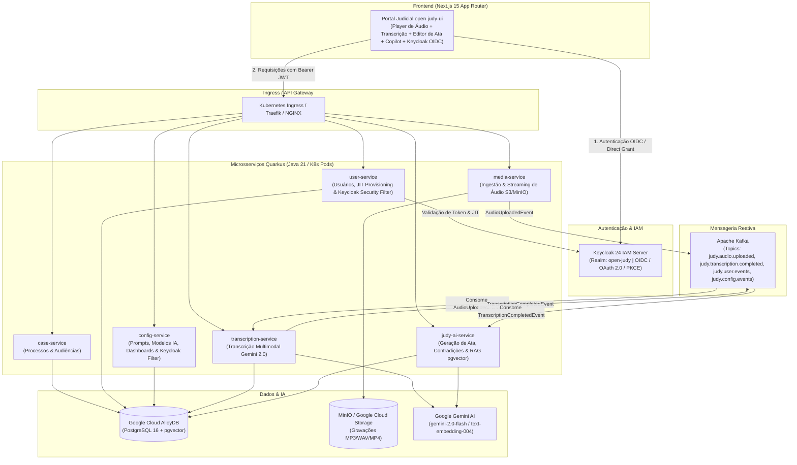

import { ProjectHeader, TerminalCallout } from '../../components/portfolio'

# Open Judy

<ProjectHeader
  name="Open Judy"
  repo="open-judy"
  branch="main"
  description="Open-source judiciary system template designed for AI-assisted document analysis and workflows."
  language="TypeScript"
  tags={["typescript","ai","legal-tech"]}
  stars={1}
  isFork={false}
  githubUrl="https://github.com/vitorecomp/open-judy"
/>

# Open Judy ⚖️🤖

> **Plataforma Aberta de Inteligência Artificial para o Poder Judiciário**
> Transcrição de Audiências, Diarização de Falas, Geração de Atas Oficiais, Copilot RAG e Autenticação Zero-Trust com Keycloak IAM, Google Gemini, Quarkus, AlloyDB e Next.js.

[](https://quarkus.io)
[-blue?logo=keycloak)](https://www.keycloak.org)
[](https://ai.google.dev)
[](https://cloud.google.com/alloydb)
[](https://nextjs.org)
[](https://kubernetes.io)

---

## 🏛️ Sobre o Open Judy

O **Open Judy** é uma solução de arquitetura orientada a microsserviços cloud-native (Kubernetes) desenvolvida para acelerar e desburocratizar o trabalho de magistrados, assessores de gabinete, promotores de justiça, defensores e advogados.

Funcionalidades centrais:
1. **Autenticação & Controle de Acesso Baseado em Papéis (RBAC) com Keycloak IAM**: Autenticação unificada via OpenID Connect (OIDC / OAuth 2.0 / JWT Bearer) com clientes públicos (`open-judy-ui`) e serviços de retaguarda (`open-judy-backend`), provimento Just-In-Time (JIT) e perfis judiciais (`MAGISTRADO`, `ASSESSOR`, `ADMIN`, `ADVOGADO`).
2. **Ingestão & Diarização com Gemini**: Transcrição de gravações de áudio/vídeo com segmentação por orador (`Magistrado`, `Promotor`, `Advogado do Autor/Réu`, `Autor`, `Réu`, `Testemunha`) e carimbos de tempo em milissegundos.
3. **Minuta da Ata de Audiência Automatizada**: Geração em segundos do termo oficial de audiência com cabeçalho da comarca, qualificação das presenças, síntese dos depoimentos colhidos, deliberações e despacho final de encerramento.
4. **Detector de Contradições e Análise Jurídica**: Mapeamento de teses conflitantes, pontos controvertidos e cronologia dos fatos com fundamentação em súmulas e jurisprudência (ex: Súmula 543 STJ).
5. **Copilot Judiciário com RAG Semântico**: Assistente conversacional alimentado por vetores no **AlloyDB `pgvector`** com geração de citações com links clicáveis que retrocedem/avançam o player de áudio para o trecho exato da fala.

---

## 🏗️ Arquitetura do Sistema



---

## 🔐 Autenticação com Keycloak (OIDC / OAuth 2.0)

O Open Judy utiliza o **Keycloak 24** como servidor central de gerenciamento de identidades e acessos (IAM):

- **Realm**: `open-judy`
- **Clients**:
  - `open-judy-ui`: Cliente público com fluxo Authorization Code Flow + PKCE (S256) e Direct Access Grants.
  - `open-judy-backend`: Cliente Bearer-only para validação de JWTs nos microsserviços Quarkus.
- **Perfis e Permissões (RBAC)**:
  - `MAGISTRADO`: Condução de audiências, análise jurídica integral, aprovação e assinatura digital de atas.
  - `ASSESSOR`: Elaboração de minutas de atas, análise de contradições, pesquisas jurídicas e suporte ao gabinete.
  - `ADMIN`: Acesso irrestrito a usuários, configurações globais, prompts, modelos de IA e auditoria.
  - `ADVOGADO`: Acompanhamento de audiências, consulta de atas públicas e manifestações.

### Usuários de Demonstração (Seed)

| Usuário | E-mail | Senha Padrão | Perfil (Role) |
|---|---|---|---|
| `camila.vasconcelos` | `camila.vasconcelos@tjsp.jus.br` | `judy123` | `MAGISTRADO` (Juíza Titular) |
| `marcos.assessor` | `marcos.assessor@tjsp.jus.br` | `judy123` | `ASSESSOR` (Assessor de Gabinete) |
| `admin.judy` | `admin@openjudy.org` | `judy123` | `ADMIN` (Administrador de TI/IA) |
| `lucas.menezes` | `lucas.menezes@advocacia.com.br` | `judy123` | `ADVOGADO` (Representante Legal) |

---

## 📁 Estrutura de Diretórios

```
open-judy/
├── services/
│   ├── pom.xml                                   # POM Pai Maven Multi-módulo
│   ├── common-lib/                               # DTOs, Eventos de Domínio, KeycloakHeaders, KeycloakPrincipal, TokenVerifier
│   ├── case-service/                             # Microsserviço Quarkus (Processos e Audiências)
│   ├── media-service/                            # Microsserviço Quarkus (Mídia e S3/GCS)
│   ├── transcription-service/                    # Microsserviço Quarkus (Produtor RabbitMQ e API de Transcrições)
│   ├── judy-ai-service/                          # Microsserviço Quarkus (Atas, RAG e Copilot)
│   ├── user-service/                             # Microsserviço Quarkus (Keycloak OIDC, JIT Provisioning, Perfis)
│   ├── config-service/                           # Microsserviço Quarkus (Prompts, Modelos, Dashboards, KeycloakFilter)
│   └── notification-service/                     # Microsserviço Quarkus (Notificações em Tempo Real, SSE, RabbitMQ)
├── pipelines/
│   └── transcription-pipeline/                   # Pipeline Assíncrono em Python (Consumidor RabbitMQ, Resiliência, Retries e Gemini)
├── frontend/
│   └── open-judy-ui/                             # Portal Next.js 15 (Keycloak Client, TypeScript, Tailwind CSS)
├── docker/
│   └── keycloak/
│       └── openjudy-realm.json                   # Exportação completa do Realm Keycloak open-judy
├── k8s/
│   ├── base/                                     # Manifestos Kubernetes (Keycloak, Services, Pipelines, ConfigMaps, Ingress)
│   └── overlays/
│       ├── local/                                # Overlay Kustomize para desenvolvimento local
│       └── gke-alloydb/                          # Overlay Kustomize para produção no GKE + AlloyDB
├── docker-compose.yml                            # Stack Docker (Keycloak, Postgres+pgvector, Kafka, RabbitMQ, MinIO)
├── podman-compose.yml                            # Stack Podman
└── README.md
```

---

## 🚀 Como Executar

### 1. Iniciar Infraestrutura Local (Keycloak, AlloyDB/PostgreSQL + pgvector, Kafka e MinIO)

```bash
# Iniciar stack local com podman-compose ou docker-compose
podman-compose up -d

# Verificar status dos containers
podman ps
```

Serviços expostos:
- **Keycloak IAM**: `http://localhost:8080` (Console Admin: `admin` / `admin`)
- **AlloyDB / PostgreSQL (`pgvector`)**: `localhost:5432` (`judy_user` / `judy_password`)
- **Apache Kafka**: `localhost:9092`
- **RabbitMQ**: `localhost:5672` (AMQP) | Console Web: `http://localhost:15672` (`judy_user` / `judy_password`)
- **MinIO Console**: `http://localhost:9001` (`judy_minio_admin` / `judy_minio_password`)

### 2. Executar os Microsserviços Quarkus

Cada microsserviço pode ser iniciado em modo de desenvolvimento (`dev mode`):

```bash
# Terminal 1: Case Service (Porta 8081)
cd services/case-service
./mvnw quarkus:dev

# Terminal 2: Media Service (Porta 8082)
cd services/media-service
./mvnw quarkus:dev

# Terminal 3: Transcription Service (Porta 8083)
cd services/transcription-service
./mvnw quarkus:dev

# Terminal 4: Judy AI Service (Porta 8084)
cd services/judy-ai-service
./mvnw quarkus:dev

# Terminal 5: User Service (Porta 8085)
cd services/user-service
./mvnw quarkus:dev

# Terminal 6: Config Service (Porta 8086)
cd services/config-service
./mvnw quarkus:dev
```

### 3. Executar o Frontend Next.js

```bash
cd frontend/open-judy-ui
npm install
npm run dev
```

Acesse o portal em: [http://localhost:3000](http://localhost:3000)

---

## ☸️ Deploy no Kubernetes

Para aplicar os manifestos com o **Kustomize**:

```bash
# Ambiente local / Minikube
kubectl apply -k k8s/overlays/local

# Ambiente Google Cloud (GKE + AlloyDB)
kubectl apply -k k8s/overlays/gke-alloydb
```

---

## 📄 Licença

Distribuído sob a licença MIT. Consulte `LICENSE` para mais informações.
