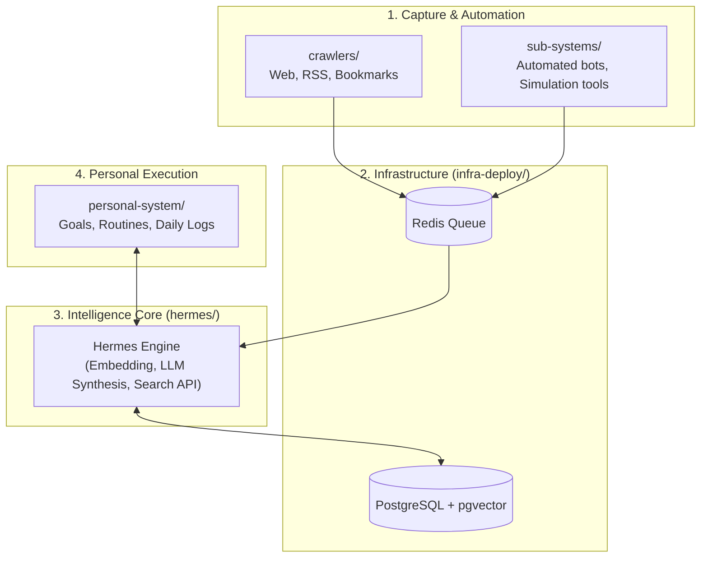

import { ProjectHeader, TerminalCallout } from '../../components/portfolio'

# Personal Life Manager

<ProjectHeader
  name="Personal Life Manager"
  repo="personal-life-manager"
  branch="master"
  description="Go service and CLI utilities for managing personal workflows, tasks, and automation."
  language="Go"
  tags={["go","backend","productivity"]}
  stars={0}
  isFork={false}
  githubUrl="https://github.com/vitorecomp/personal-life-manager"
/>

# 🧠 Personal Life Manager (Second Brain)

A modular, automated **Second Brain** platform designed to capture external knowledge, synthesize insights using AI, track personal goals and routines, and automate background tasks.

---

## 🏗️ Architecture Overview



---

## 📂 Repository Structure

| Module | Description | Quick Link |
| :--- | :--- | :--- |
| **`crawlers/`** | Web scrapers, RSS ingestion, bookmark synchronizers, and content fetchers. | [Explore Crawlers](https://github.com/vitorecomp/personal-life-manager/blob/master/file:///home/vitor/workspace/personal/personal-life-manager/crawlers/README.md) |
| **`documentation/`** | System architecture, data flow diagrams, and Second Brain methodology. | [View Docs](https://github.com/vitorecomp/personal-life-manager/blob/master/file:///home/vitor/workspace/personal/personal-life-manager/documentation/README.md) |
| **`hermes/`** | Core engine: LLM orchestration, semantic search, vector indexing, and assistant API. | [Explore Hermes](https://github.com/vitorecomp/personal-life-manager/blob/master/file:///home/vitor/workspace/personal/personal-life-manager/hermes/README.md) |
| **`infra-deploy/`** | Docker Compose configurations (Postgres/pgvector, Redis), environment templates, and deployment scripts. | [View Deploy Specs](https://github.com/vitorecomp/personal-life-manager/blob/master/file:///home/vitor/workspace/personal/personal-life-manager/infra-deploy/README.md) |
| **`personal-system/`** | Full-stack platform (Golang API + Next.js UI) to administer time, tasks, and servers, plus goals and routines. | [View Personal System](https://github.com/vitorecomp/personal-life-manager/blob/master/file:///home/vitor/workspace/personal/personal-life-manager/personal-system/README.md) |
| **`sub-systems/`** | Standalone sub-systems, automated bots, and game tools (`auto-players`, `satisfatory-plan`). | [Explore Sub-Systems](https://github.com/vitorecomp/personal-life-manager/blob/master/file:///home/vitor/workspace/personal/personal-life-manager/sub-systems/README.md) |
| **`scripts/`** | Helper scripts (e.g. syncing Obsidian Second Brain GitHub repository). | [Explore Scripts](https://github.com/vitorecomp/personal-life-manager/blob/master/file:///home/vitor/workspace/personal/personal-life-manager/scripts/README.md) |
| **`database/`** *(gitignored)* | Local clone of your Obsidian Second Brain markdown vault. | Synced via `./scripts/download_brain.sh` |

---

## ⚡ Quickstart

### 1. Prerequisites
- Docker & Docker Compose
- Python 3.10+
- Git

### 2. Configure Environment & Sync Obsidian Database
```bash
# Copy and configure environment variables
cp .env.example .env
# Set OBSIDIAN_BRAIN_REPO_URL in .env

# Clone or pull your Obsidian Second Brain into database/
./scripts/download_brain.sh
```

### 3. Launch Local Infrastructure
```bash
cp infra-deploy/.env.example infra-deploy/.env
cd infra-deploy
docker compose up -d
```

### 3. Verify Hermes Core
```bash
python hermes/main.py --status
```

---

## 📖 Key Documentation
- [System Architecture](https://github.com/vitorecomp/personal-life-manager/blob/master/file:///home/vitor/workspace/personal/personal-life-manager/documentation/architecture.md)
- [Second Brain Methodology](https://github.com/vitorecomp/personal-life-manager/blob/master/file:///home/vitor/workspace/personal/personal-life-manager/documentation/methodology.md)
